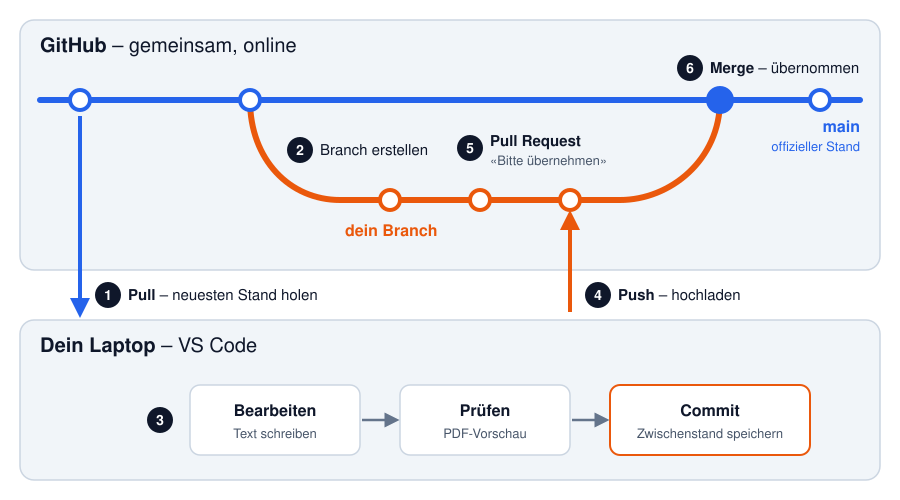

# Anleitung: An der Dokumentation mitarbeiten

Diese Anleitung richtet sich an alle im Team, die noch nie mit Git, GitHub oder
Typst gearbeitet haben. Sie führt Schritt für Schritt von der Installation bis
zur eigenen Änderung im Bericht.

Allgemeines (Installation, Bedienung von Git und GitHub, Typst-Syntax) erklären
die offiziellen Anleitungen besser, als wir es könnten – dorthin wird jeweils
mit **📖** verlinkt. Hier steht vor allem, **wie wir es in diesem Projekt
machen**.

**Inhalt**

1. [Worum geht es?](#1-worum-geht-es)
2. [Nur anschauen – ganz ohne Installation](#2-nur-anschauen--ganz-ohne-installation)
3. [Einmalige Einrichtung](#3-einmalige-einrichtung)
4. [Der Arbeitsablauf für jede Änderung](#4-der-arbeitsablauf-für-jede-änderung)
5. [Typst in unserem Projekt](#5-typst-in-unserem-projekt)
6. [Feedback geben, ohne selbst zu ändern](#6-feedback-geben-ohne-selbst-zu-ändern)
7. [Probleme und Lösungen](#7-probleme-und-lösungen)
8. [Spickzettel](#8-spickzettel)
9. [Weiterführende Quellen](#9-weiterführende-quellen)

---

## 1. Worum geht es?

| Werkzeug    | Was es ist                                                                                     |
|-------------|------------------------------------------------------------------------------------------------|
| **Typst**   | Sprache, in der wir den Bericht schreiben. Aus Textdateien (`.typ`) entsteht ein PDF.          |
| **Git**     | Programm, das jede Änderung an den Dateien speichert und nachvollziehbar macht.                |
| **GitHub**  | Webseite, auf der unser Projekt liegt: <https://github.com/EriN-B/pren-docs>                   |
| **VS Code** | Editor, in dem du die Dateien bearbeitest, das PDF live siehst und Git per Mausklick bedienst. |

### Warum nicht einfach Word?

- Alle können gleichzeitig an verschiedenen Kapiteln arbeiten, ohne sich gegenseitig zu überschreiben.
- Jede Änderung ist mit Name, Datum und Begründung gespeichert und lässt sich rückgängig machen.
- Layout, Nummerierung, Verzeichnisse und Quellen macht die Vorlage automatisch – alle Berichte sehen gleich aus.
- Bei jeder Änderung baut GitHub automatisch ein PDF zum Anschauen.

### Das Wichtigste in einem Bild



- **`main`** ist der offizielle Stand des Berichts. Dort arbeitet niemand direkt.
- Für jede Änderung erstellst du einen eigenen **Branch** (eine Abzweigung zum Arbeiten).
- Du speicherst deine Arbeit in **Commits** und lädst sie mit **Push** auf GitHub.
- Mit einem **Pull Request (PR)** schlägst du vor, die Änderungen in `main` zu übernehmen. Nach dem Review wird er **gemergt**.

Die Nummern im Bild entsprechen der Reihenfolge in [Kapitel 4](#4-der-arbeitsablauf-für-jede-änderung).

📖 Zum Verstehen, 10–20 Minuten:
- [Was ist Versionsverwaltung?](https://git-scm.com/book/de/v2/Erste-Schritte-Was-ist-Versionsverwaltung%3F) – Pro Git, Deutsch
- [GitHub flow](https://docs.github.com/de/get-started/using-github/github-flow) – genau der Ablauf aus dem Bild, offizielle GitHub-Doku
- [Learn Git Branching](https://learngitbranching.js.org/?locale=de_DE) – interaktives Spiel, sehr anschaulich (die ersten paar Levels genügen)
- [GitHub-Glossar](https://docs.github.com/de/get-started/learning-about-github/github-glossary) – alle Fachbegriffe

---

## 2. Nur anschauen – ganz ohne Installation

- **Fertige PDFs:** <https://github.com/EriN-B/pren-docs/releases> → beim gewünschten Eintrag (z. B. `milestone_1/v1.2.0`) unter **Assets** die Datei `TEAM3-….pdf` herunterladen.
- **Entwürfe:** <https://github.com/EriN-B/pren-docs/pulls> → Pull Request öffnen → im Kommentar des Bots auf den Download-Link klicken. Das PDF hat das Wasserzeichen «ENTWURF».
- **Quelltexte:** Auf <https://github.com/EriN-B/pren-docs> durch die Ordner klicken. Die Kapitel liegen in `docs/deliveries/<abgabe>/chapters/`.

---

## 3. Einmalige Einrichtung

Plane etwa 30 Minuten ein. Du machst das nur einmal pro Laptop.

### 3.1 GitHub-Konto

1. Konto erstellen (gratis). 📖 [Erstellen eines Kontos auf GitHub](https://docs.github.com/de/get-started/start-your-journey/creating-an-account-on-github)
2. Schicke deinen **GitHub-Benutzernamen** an Erin.
3. Du bekommst eine E-Mail von GitHub → **Accept invitation**. (Oder <https://github.com/EriN-B/pren-docs/invitations> öffnen.) Ohne angenommene Einladung kannst du nichts hochladen.

### 3.2 Git installieren

📖 [Git installieren](https://git-scm.com/book/de/v2/Erste-Schritte-Git-installieren) – Pro Git, Deutsch

- **Windows:** Installer von <https://git-scm.com/downloads/win> herunterladen und mit den Voreinstellungen durchklicken.
- **macOS:** Im Terminal `xcode-select --install` eingeben und bestätigen.

Prüfen: In einem Terminal `git --version` eingeben – es sollte eine Versionsnummer erscheinen.

### 3.3 Git sagen, wer du bist

Jeder Commit wird mit deinem Namen gespeichert. Im Terminal (mit deinen Angaben,
E-Mail wie im GitHub-Konto):

```sh
git config --global user.name "Vorname Nachname"
git config --global user.email "deine.mail@example.com"
```

📖 [Git Basis-Konfiguration](https://git-scm.com/book/de/v2/Erste-Schritte-Git-Basis-Konfiguration)

### 3.4 VS Code installieren

Download: <https://code.visualstudio.com/download>

📖 Installation für [Windows](https://code.visualstudio.com/docs/setup/windows) · [macOS](https://code.visualstudio.com/docs/setup/mac) · optional [VS Code auf Deutsch umstellen](https://code.visualstudio.com/docs/getstarted/locales)

> In dieser Anleitung stehen die Menübegriffe auf Englisch und in Klammern auf
> Deutsch.

### 3.5 Das Projekt herunterladen («klonen»)

1. In VS Code links **Source Control** (**Quellcodeverwaltung**) öffnen (`Ctrl+Shift+G`, Mac `Cmd+Shift+G`) → **Clone Repository** (**Repository klonen**).
2. Diese Adresse einfügen und Enter drücken:
   ```
   https://github.com/EriN-B/pren-docs.git
   ```
3. Ordner wählen (z. B. `Dokumente/HSLU`) → **Open** → **Yes, I trust the authors**.

📖 [Introduction to Git in VS Code](https://code.visualstudio.com/docs/sourcecontrol/intro-to-git) – zeigt Klonen, Commit, Push und Pull mit Bildern und Video

### 3.6 Typst-Erweiterung «Tinymist» installieren

Tinymist bringt Typst mit – du musst Typst nicht separat installieren.

Beim Öffnen des Projekts schlägt VS Code die Erweiterung unten rechts vor →
**Install**. Falls nicht: links **Extensions** (vier Quadrate) → «Tinymist»
suchen → **Install**.

Die nötigen Einstellungen (Schriftart, Projektordner) sind schon im Projekt in
`.vscode/settings.json` hinterlegt. Du musst nichts konfigurieren.

📖 [Tinymist im Marketplace](https://marketplace.visualstudio.com/items?itemName=myriad-dreamin.tinymist) · [Tinymist-Doku für VS Code](https://myriad-dreamin.github.io/tinymist/frontend/vscode.html)

### 3.7 Test: PDF-Vorschau öffnen

1. Im Explorer `docs/deliveries/milestone_2/doc.typ` öffnen.
2. Oben rechts im Editor auf das Vorschau-Symbol klicken (Tooltip «Preview»). Alternativ `Ctrl+Shift+P` / `Cmd+Shift+P` → **Typst Preview: Preview Opened File**.
3. Rechts erscheint der Bericht und aktualisiert sich bei jeder Änderung.

> **Wichtig:** Öffne die Vorschau immer über die `doc.typ` der Abgabe, nicht
> über ein einzelnes Kapitel – die Kapitel funktionieren nur zusammen mit der
> `doc.typ`. Die Vorschau bleibt offen und aktualisiert sich auch, wenn du
> danach ein Kapitel bearbeitest.

### 3.8 Beim ersten Hochladen: bei GitHub anmelden

Beim ersten **Push** (4.5) fragt VS Code, ob es sich bei GitHub anmelden darf →
**Allow** → im Browser anmelden und bestätigen. Das passiert nur einmal.

---

## 4. Der Arbeitsablauf für jede Änderung

Diese Schritte machst du **jedes Mal**. Wie die Knöpfe in VS Code genau
aussehen, zeigt 📖 [Source Control in VS Code](https://code.visualstudio.com/docs/sourcecontrol/overview).

**Orientierung:** Unten links in der Statusleiste steht der Branch, auf dem du
gerade bist. Ein Klick darauf öffnet das Branch-Menü.

### 4.1 Neuesten Stand holen

Unten links auf `main` wechseln → in Source Control **…** → **Pull**.

### 4.2 Branch erstellen

Unten links auf den Branch-Namen klicken → **+ Create new branch…** → Namen eingeben.

**Unser Namensschema** (klein, Bindestriche, keine Umlaute, keine Leerzeichen):

```
docs/<abgabe>-<thema>     z. B. docs/milestone-2-antrieb
fix/<was>                 z. B. fix/tippfehler-risikoanalyse
```

Ein Branch pro Thema. Für zwei unabhängige Dinge zwei Branches – dann können
sie unabhängig übernommen werden.

📖 [Branches in VS Code](https://code.visualstudio.com/docs/sourcecontrol/branches-worktrees)

### 4.3 Bearbeiten und prüfen

1. Vorschau über die `doc.typ` der Abgabe öffnen (3.7).
2. Kapitel in `docs/deliveries/<abgabe>/chapters/` bearbeiten und speichern (`Ctrl+S` / `Cmd+S`, oder **File → Auto Save** aktivieren).
3. Fehler werden rot unterstrichen; alle Fehler zeigt **View → Problems**. Bitte nur fehlerfreie Stände hochladen – sonst kann GitHub kein PDF bauen.

### 4.4 Commit

In Source Control die Dateien mit **+** stagen, Nachricht eingeben, **✓ Commit**.

**Unser Schema für die Nachricht:**

```
docs(<abgabe>): Was wurde gemacht
```

Beispiele: `docs(milestone_2): Lösungsprinzipien Antrieb ergänzt`,
`fix(milestone_1): Tippfehler in Risikoanalyse korrigiert`.

Mach ruhig mehrere Commits, z. B. nach jedem fertigen Abschnitt.

### 4.5 Push

**Publish Branch** (beim ersten Mal) bzw. **Sync Changes** klicken. Erst jetzt
ist deine Arbeit auf GitHub. Tipp: Auch Zwischenstände hochladen, z. B. am Ende
des Tages.

### 4.6 Pull Request erstellen

1. <https://github.com/EriN-B/pren-docs> öffnen → gelber Balken **Compare & pull request**.
2. Prüfen: **base: main** ← **compare: dein Branch**.
3. Titel und Beschreibung: Was hast du geändert, wo soll jemand besonders hinschauen, gibt es offene Fragen?
4. Bei **Reviewers** Erin auswählen → **Create pull request**.

📖 [Erstellen eines Pull Requests](https://docs.github.com/de/pull-requests/collaborating-with-pull-requests/proposing-changes-to-your-work-with-pull-requests/creating-a-pull-request)

**Was danach automatisch passiert:**

- Nach einigen Minuten baut GitHub das Vorschau-PDF und verlinkt es als Kommentar im PR.
- Ein grüner Haken ✓ heisst: Das Dokument lässt sich bauen. Ein rotes ✕ heisst: Fehler, siehe [7.](#7-probleme-und-lösungen)
- Die **Labels** (`release:major` usw.) steuern die Versionsnummer des PDFs. Die setzt Erin – du musst dich nicht darum kümmern.

### 4.7 Review, Korrekturen, Merge

- **Korrekturen einarbeiten:** Auf deinem Branch bleiben (unten links prüfen!), ändern, Commit, Sync Changes. Der PR und das Vorschau-PDF aktualisieren sich automatisch – kein neuer PR nötig. 📖 [Feedback einarbeiten](https://docs.github.com/de/pull-requests/collaborating-with-pull-requests/reviewing-changes-in-pull-requests/incorporating-feedback-in-your-pull-request)
- **Merge:** Wenn alles passt, mergt Erin den PR. Danach erstellt GitHub automatisch das neue PDF unter **Releases**.
- **Danach:** Auf `main` wechseln, **Pull**, und für die nächste Änderung wieder bei 4.1 beginnen.

---

## 5. Typst in unserem Projekt

📖 **Zum Lernen:** Das offizielle [Typst-Tutorial](https://typst.app/docs/tutorial/)
(Englisch, sehr gut erklärt). Das erste Kapitel «Writing in Typst» reicht für
den Anfang. Zum Nachschlagen: [Syntax-Übersicht](https://typst.app/docs/reference/syntax/).

Nummerierung, Inhaltsverzeichnis, Seitenzahlen, Layout sowie Abbildungs- und
Tabellenverzeichnis macht unsere Vorlage automatisch. Nichts von Hand
nummerieren oder formatieren.

### Wo liegt was?

```
docs/
  deliveries/                 Eine Abgabe pro Ordner
    milestone_2/
      doc.typ                 Hauptdatei: Titelseite und Reihenfolge der Kapitel
      chapters/               Die einzelnen Kapitel – hier schreibst du meistens
      assets/                 Bilder dieser Abgabe
  library/                    Gemeinsam für alle Abgaben – nur nach Absprache ändern
    template.typ              Vorlage (Layout, Schrift, Titelseite)
    quellen.bib               Quellenverzeichnis für alle Abgaben
```

Eine bereits freigegebene Abgabe ändern wir nur noch für Korrekturen. Neue
Inhalte kommen in die aktuelle Abgabe.

### Schreibregeln

- **Schweizer Rechtschreibung:** `ss` statt `ß` (gross, Strasse, Massnahme).
- **Anführungszeichen:** «so» – am einfachsten hier kopieren: « »
- **Zahlen:** Dezimalpunkt (`0.5 m/s`), Geldbeträge als `CHF 200.–`.
- Ganze Sätze, sachlicher Berichtsstil.
- Offene Punkte als `// TODO: …` markieren – erscheint nicht im PDF.

### Labels und Verweise

Kapitel, Tabellen und Abbildungen bekommen ein Label, auf das du mit `@` verweist:

```typst
== Sensorik <kap-sensorik>
Wie in @kap-sensorik beschrieben …
```

**Unser Schema:** `<kap-…>` für Kapitel, `<tab-…>` für Tabellen, `<fig-…>` für
Abbildungen – klein, mit Bindestrichen, ohne Umlaute. Bestehende Labels nicht
umbenennen, andere Kapitel verweisen vielleicht darauf. Jede Tabelle und
Abbildung wird im Text erwähnt, bevor sie erscheint.

📖 [Verweise (ref)](https://typst.app/docs/reference/model/ref/)

### Tabellen

Tabellen kommen immer in eine `figure` mit Beschriftung und Label:

```typst
Die Varianten sind in @tab-antrieb verglichen.

#figure(
  table(
    columns: (auto, 1fr, 1fr),
    table.header([Kriterium], [Räder], [Beine]),
    [Kosten], [gering], [hoch],
    [Geschwindigkeit], [hoch], [gering],
  ),
  caption: [Vergleich der Antriebsvarianten],
) <tab-antrieb>
```

- Linien und Farben macht die Vorlage – nicht selbst einfärben.
- Viele Kapitel haben oben eigene Hilfsfunktionen für Tabellen (z. B. `bewertung` und `tech-tabelle` in der Technologierecherche von Meilenstein 1). Ein bestehendes Beispiel kopieren statt neu anfangen.

📖 [Tabellen-Guide](https://typst.app/docs/guides/tables/) · [figure](https://typst.app/docs/reference/model/figure/)

### Bilder

1. Bild (PNG/JPG) in `docs/deliveries/<abgabe>/assets/` legen. Dateiname klein, ohne Umlaute und Leerzeichen.
2. Im Kapitel einbinden – der Pfad ist relativ zur Kapiteldatei, darum `../assets/…`:

```typst
Der Aufbau ist in @fig-antrieb dargestellt.

#figure(
  image("../assets/antrieb.png", width: 70%),
  caption: [Skizze des Antriebs],
) <fig-antrieb>
```

📖 [image](https://typst.app/docs/reference/visualize/image/)

### Quellen

Alle Quellen stehen in `docs/library/quellen.bib`. Eintrag für eine Webseite:

```bib
@online{reichelt-pi5,
  title  = {Raspberry Pi 5, 8 GB RAM},
  author = {{reichelt elektronik}},
  url    = {https://www.reichelt.com/...},
}
```

Im Text: `@reichelt-pi5`, mehrere Quellen `@quelle-a @quelle-b`, die
Aufgabenstellung `@aufgabe`. Das Quellenverzeichnis entsteht automatisch.

**Unsere Regeln:**
- Neue Einträge unter das passende Thema (Abschnitte mit `% ── Thema ───` markiert).
- Schlüssel klein mit Bindestrichen: `<quelle>-<ding>`.
- Keine bestehenden Einträge löschen – ältere Abgaben brauchen sie vielleicht noch.
- URL vollständig und echt; Links werden jede Woche automatisch geprüft.

📖 [bibliography](https://typst.app/docs/reference/model/bibliography/)

### Neues Kapitel anlegen

1. Datei in `chapters/` erstellen, z. B. `chapters/antrieb.typ` (klein, ohne Umlaute).
2. Kopfkommentar und Überschrift von einem bestehenden Kapitel übernehmen:
   ```typst
   // ─────────────────────────────────────────────────────────────
   //  Kapitel: Antrieb
   //  Wird in «doc.typ» per #include eingebunden.
   // ─────────────────────────────────────────────────────────────

   = Antrieb <kap-antrieb>
   ```
3. In der `doc.typ` an der richtigen Stelle (vor `#bibliography(…)`) einbinden:
   ```typst
   #include "chapters/antrieb.typ"
   ```

---

## 6. Feedback geben, ohne selbst zu ändern

Kommentare im Pull Request sind oft der schnellste Weg mitzuarbeiten – ganz ohne
Installation:

- **Allgemeiner Kommentar:** PR öffnen → unten ins Kommentarfeld schreiben.
- **Kommentar zu einer Zeile oder konkreter Textvorschlag:** Reiter **Files changed** → bei der Zeile auf **+** klicken. Mit dem Symbol **±** (*Add a suggestion*) schlägst du direkt neuen Text vor, den man mit einem Klick übernehmen kann.
- **Review abschliessen:** **Submit review** → *Comment*, *Approve* (passt) oder *Request changes* (bitte korrigieren).

📖 [Kommentieren eines Pull Requests](https://docs.github.com/de/pull-requests/collaborating-with-pull-requests/reviewing-changes-in-pull-requests/commenting-on-a-pull-request) · [Überprüfen von Änderungen in Pull Requests](https://docs.github.com/de/pull-requests/collaborating-with-pull-requests/reviewing-changes-in-pull-requests/reviewing-proposed-changes-in-a-pull-request)

**Kleine Korrektur direkt im Browser:** Datei auf GitHub öffnen → Stift-Symbol →
ändern → **Commit changes…** → unbedingt **Create a new branch for this commit
and start a pull request** wählen (nicht direkt in `main`!). Nachteil: keine
Live-Vorschau; das Vorschau-PDF kommt nach ein paar Minuten im PR.
📖 [Bearbeiten von Dateien](https://docs.github.com/de/repositories/working-with-files/managing-files/editing-files)

---

## 7. Probleme und Lösungen

### «Ich habe aus Versehen auf `main` gearbeitet»

- **Noch nicht committet:** Unten links **Create new branch…** – deine Änderungen kommen auf den neuen Branch mit.
- **Schon committet, nicht gepusht:** Bei Erin melden, das ist schnell behoben. Nicht auf `main` pushen.

### Merge-Konflikt

Entsteht, wenn zwei Personen dieselbe Stelle geändert haben. VS Code zeigt die
betroffenen Stellen an, und du wählst, welche Version bleibt.
📖 [Merge-Konflikte in VS Code](https://code.visualstudio.com/docs/sourcecontrol/merge-conflicts) · [Informationen zu Merge-Konflikten](https://docs.github.com/de/pull-requests/collaborating-with-pull-requests/addressing-merge-conflicts/about-merge-conflicts)

Bei Unsicherheit: aufhören und bei Erin melden – kaputt geht nichts, solange du
nicht pushst. **Vorbeugen:** vor dem Start immer Pull (4.1), kleine Branches,
kurz absprechen, wer an welchem Kapitel arbeitet.

### «This branch is out-of-date with the base branch»

Im PR auf **Update branch** klicken, danach in VS Code **Sync Changes**.
📖 [PR mit dem Basisbranch synchron halten](https://docs.github.com/de/pull-requests/collaborating-with-pull-requests/proposing-changes-to-your-work-with-pull-requests/keeping-your-pull-request-in-sync-with-the-base-branch)

### «Push abgelehnt»

Jemand anders hat auf denselben Branch hochgeladen. **Sync Changes** klicken –
das holt zuerst die fremden Änderungen und lädt dann deine hoch.

### Die Vorschau zeigt nichts oder einen Fehler

- Vorschau über die `doc.typ` geöffnet (nicht über ein Kapitel)? Sonst schliessen und neu öffnen.
- **View → Problems** anschauen. Häufige Ursachen in unserem Projekt:
  - Klammer `(`, `[` oder `{` nicht geschlossen.
  - Verweis auf ein Label, das es nicht gibt (`@tab-xyz` ohne `<tab-xyz>`).
  - Quelle `@xyz` fehlt in `quellen.bib`.
  - Bildpfad falsch (Gross-/Kleinschreibung, `../assets/…`).
  - `#`, `*`, `_` oder `@` im Text wird als Befehl verstanden → `\` davor schreiben (`\#`).
- Nichts hilft? `Ctrl+Shift+P` / `Cmd+Shift+P` → **Developer: Reload Window**.

### Der Haken im PR ist rot ✕

Im PR neben dem ✕ auf **Details** klicken. Unten im Log steht die
Typst-Fehlermeldung mit Datei und Zeile – dieselbe, die du lokal unter
**View → Problems** siehst.

### Ich sehe meine Änderungen auf GitHub nicht

Gespeichert? Committet (4.4)? Gepusht (4.5)? Auf GitHub den richtigen Branch
ausgewählt (oben links auf der Projektseite)?

### VS Code fragt nach Benutzername/Passwort

Nicht das GitHub-Passwort eingeben. Dialog abbrechen → unten links
Personen-Symbol (**Accounts**) → **Sign in with GitHub** → nochmals pushen.

---

## 8. Spickzettel

| Schritt                  | Wo in VS Code                                         |
|--------------------------|-------------------------------------------------------|
| 1. Auf `main` wechseln   | Unten links auf Branch-Name → `main`                  |
| 2. Neuesten Stand holen  | Source Control → **…** → **Pull**                     |
| 3. Neuer Branch          | Unten links → **Create new branch…** → `docs/…`       |
| 4. Vorschau öffnen       | `doc.typ` öffnen → Vorschau-Symbol oben rechts        |
| 5. Bearbeiten, speichern | `Ctrl+S` / `Cmd+S`                                    |
| 6. Commit                | Source Control → **+** → Nachricht → **✓ Commit**     |
| 7. Hochladen             | **Publish Branch** bzw. **Sync Changes**              |
| 8. Pull Request          | github.com → **Compare & pull request**               |
| 9. Nach dem Merge        | Zurück zu Schritt 1                                   |

Für Terminal-Fans (in VS Code: **Terminal → New Terminal**):

```sh
git switch main && git pull            # neuesten Stand holen
git switch -c docs/milestone-2-thema   # neuen Branch erstellen
git add . && git commit -m "docs(milestone_2): …"
git push -u origin HEAD                # erster Push, danach nur: git push
```

---

## 9. Weiterführende Quellen

| Thema                | Quelle                                                                                         |
|----------------------|------------------------------------------------------------------------------------------------|
| Git verstehen        | [Pro Git (Deutsch, komplettes Buch)](https://git-scm.com/book/de/v2) – Kapitel 1–3 reichen     |
| Git ausprobieren     | [Learn Git Branching (interaktiv)](https://learngitbranching.js.org/?locale=de_DE)             |
| Git in VS Code       | [Source Control in VS Code](https://code.visualstudio.com/docs/sourcecontrol/overview)         |
| Ablauf mit GitHub    | [GitHub flow](https://docs.github.com/de/get-started/using-github/github-flow)                 |
| Pull Requests        | [Informationen zu Pull Requests](https://docs.github.com/de/pull-requests/collaborating-with-pull-requests/proposing-changes-to-your-work-with-pull-requests/about-pull-requests) |
| Releases             | [Informationen zu Releases](https://docs.github.com/de/repositories/releasing-projects-on-github/about-releases) |
| Fachbegriffe         | [GitHub-Glossar](https://docs.github.com/de/get-started/learning-about-github/github-glossary) |
| Typst lernen         | [Typst-Tutorial](https://typst.app/docs/tutorial/)                                             |
| Typst nachschlagen   | [Typst-Referenz](https://typst.app/docs/reference/syntax/)                                     |
| Tinymist (Vorschau)  | [Tinymist-Doku für VS Code](https://myriad-dreamin.github.io/tinymist/frontend/vscode.html)    |

---

Fragen? Melde dich bei Erin – oder schreib einen Kommentar in einen Pull Request.
